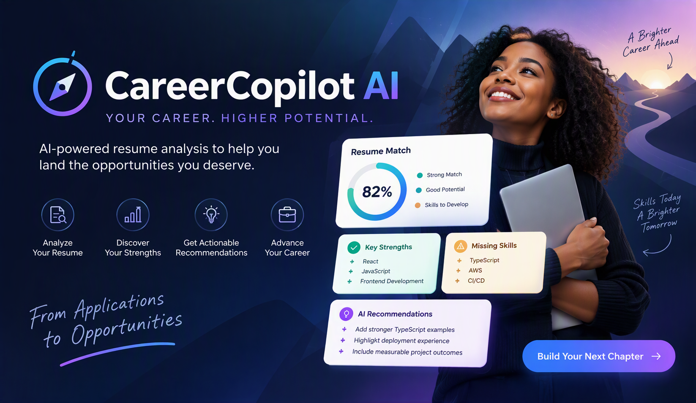
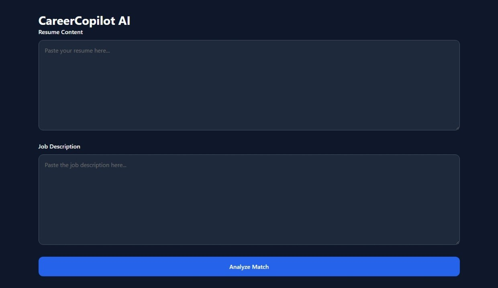
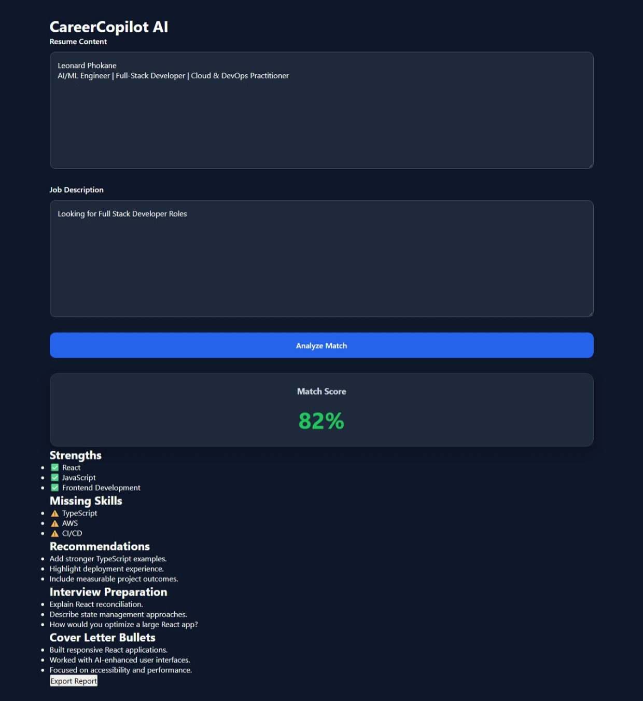
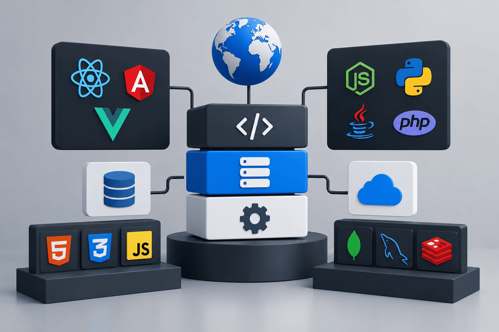
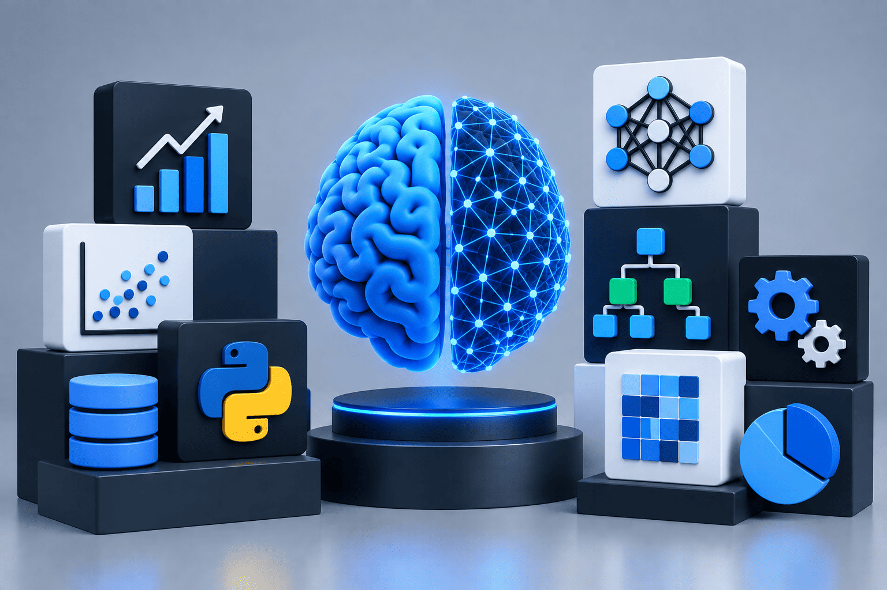
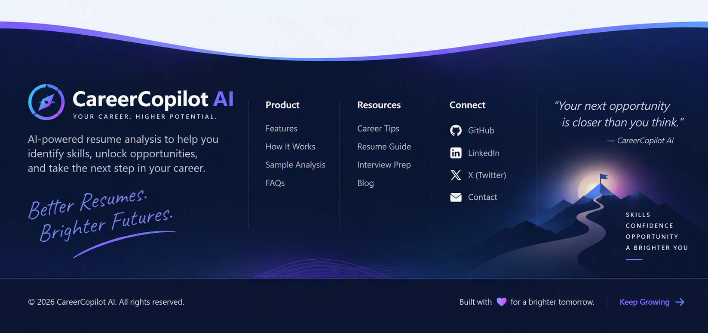

# CareerCopilot AI




> AI-Powered Resume Analysis & Career Guidance Platform

## Project Brief


CareerCopilot AI is a frontend application that helps job seekers evaluate how well their resume aligns with a target job description. The application analyzes resume content, identifies strengths, highlights missing skills, generates recommendations, suggests interview preparation questions, and provides cover letter talking points. The project was chosen because resume optimization is a common challenge for graduates and professionals, and AI-assisted career guidance can help users improve job application outcomes.

---

## Live Application

[**Deployment URL:**](https://careercopilot-ai-jet.vercel.app/)


---

## Features

### Resume Analysis

- Resume content input
- Job description input
- Match score calculation
- Skills gap analysis

### Career Recommendations

- Strengths identification
- Missing skills detection
- Improvement recommendations
- Interview preparation questions
- Cover letter bullet suggestions

### User Experience

- Responsive interface
- Loading states
- Error states
- Form validation
- Export report functionality

---

## Screenshots

<details>
  <summary><b>CareerCopilot AI</b></summary>

  <br>

  

</details>

<br>

<details>
  <summary><b>MVP UI</b></summary>

  <br>

  

</details>


## 🛠️ Technology Stack

| 🚀 Frontend | 🧪 Testing | 🤖 AI Architecture |
|------------|------------|-------------------|
|  |  |  |
| React<br>Vite<br>JavaScript (ES6+)<br>SCSS Modules<br>Custom Hooks | Vitest<br>Unit Tests<br>Component Tests<br>Coverage Reports | Anthropic Claude API *(Planned Integration)*<br>Custom Prompt Builder<br>Structured Response Parser<br>Analysis Schema Validation |

---

## Project Structure

```text
src/
│
├── app/
│   ├── App.jsx
│   └── routes.jsx
│
├── components/
│   ├── AnalyzeButton/
│   ├── ResumeUploader/
│   ├── JobDescriptionInput/
│   ├── MatchScoreCard/
│   ├── StrengthsList/
│   ├── MissingSkills/
│   ├── Recommendations/
│   ├── InterviewPrep/
│   ├── CoverLetterBullets/
│   ├── LoadingState/
│   ├── ErrorState/
│   └── ExportReportButton/
│
├── hooks/
│   ├── useAnalysis.js
│   ├── useClaude.js
│   └── useResumeValidation.js
│
├── pages/
│   ├── Home/
│   ├── Analysis/
│   └── NotFound/
│
├── services/
│   ├── anthropicService.js
│   ├── parser.js
│   └── promptBuilder.js
│
├── schemas/
│   └── analysisSchema.js
│
├── styles/
│
├── tests/
│
└── utils/
```

---

## Installation

### Clone Repository

```bash
git clone https://github.com/YOUR_USERNAME/careercopilot-ai.git
```

### Navigate Into Project

```bash
cd careercopilot-ai
```

### Install Dependencies

```bash
npm install
```

### Start Development Server

```bash
npm run dev
```

### Open Application

```text
http://localhost:5173
```

---

## Available Scripts

### Start Development Server

```bash
npm run dev
```

### Build Production Version

```bash
npm run build
```

### Preview Production Build

```bash
npm run preview
```

### Run Tests

```bash
npx vitest
```

---

## AI Integration

CareerCopilot AI was designed to support AI-powered resume analysis through Anthropic Claude.

### Planned AI Workflow

```text
Resume Content
        +
Job Description
        ↓
Prompt Builder
        ↓
Claude API
        ↓
Structured JSON Response
        ↓
Schema Validation
        ↓
CareerCopilot Results Dashboard
```

### Expected Analysis Output

```json
{
  "matchScore": 85,
  "strengths": [],
  "missingSkills": [],
  "recommendations": [],
  "interviewQuestions": [],
  "coverLetterBullets": []
}
```

### Why AI?

Traditional resume scanners only identify keywords. AI allows CareerCopilot AI to provide contextual recommendations, explain missing competencies, and generate actionable career advice.

---

## Validation & Error Handling

The application includes:

- Resume validation
- Job description validation
- Loading states
- Error states
- Structured response validation
- API error handling architecture

Example errors:

```text
Resume content is required.

Job description is required.

Analysis service unavailable.

Invalid response received.
```

---

## Testing

### Current Test Coverage

- Analysis data validation
- Match score validation
- Utility validation functions

### Run Tests

```bash
npx vitest
```

### Coverage Report

```bash
npx vitest run --coverage
```

---

## Accessibility

Accessibility considerations include:

- Semantic HTML structure
- Accessible form controls
- Label associations
- Keyboard navigation support
- Readable typography
- Responsive layouts

### Planned Audit Tools

- axe DevTools
- Lighthouse
- WAVE

---

## Performance

Target Lighthouse Scores:

| Category | Target |
|-----------|-----------|
| Performance | 85+ |
| Accessibility | 90+ |
| Best Practices | 90+ |
| SEO | 85+ |

---

## Deployment

### Deployment Platform

Vercel

### Build Command

```bash
npm run build
```

### Output Directory

```text
dist
```

### Environment Variables

```env
ANTHROPIC_API_KEY=YOUR_API_KEY
```

---

## Deployment Checklist

- [x] Application builds successfully
- [x] Responsive layout implemented
- [x] Validation implemented
- [x] Error states implemented
- [x] Loading states implemented
- [ ] AI integration verified
- [ ] Lighthouse audit completed
- [ ] Accessibility audit completed
- [ ] Tests passing
- [ ] Production deployment verified

---

## Known Limitations

- Current MVP uses mock analysis data
- Claude integration requires production verification
- Export functionality requires additional testing
- File upload parsing not yet implemented

---

## Future Improvements

### Short Term

- Complete Claude API integration
- Improve validation feedback
- Expand testing coverage

### Long Term

- Resume file uploads (PDF/DOCX)
- Saved analysis history
- User authentication
- Job board integrations
- Personalized career coaching
- Industry-specific recommendations

---

## Monitoring & Rollback Strategy

### Monitoring

- Vercel deployment logs
- Browser console monitoring
- API error tracking

### Rollback Plan

If a deployment introduces issues:

1. Revert to the previous stable Git commit.
2. Redeploy the last known working version.
3. Verify application functionality.
4. Re-test critical user flows.

---

## Reflection

### What Was Hardest?

Managing project architecture and transitioning from a prototype concept to a structured, production-ready frontend application was the most challenging aspect of the project.

### What Would You Do Differently?

I would finalize the project structure earlier, reduce duplicate project scaffolding, and integrate external services sooner in the development lifecycle.

### What Surprised You?

The amount of effort required to prepare an application for production deployment was significantly greater than building the initial user interface.

---

## Author

**Leonard Phokane**

---

> CareerCopilot AI Capstone Project

---


